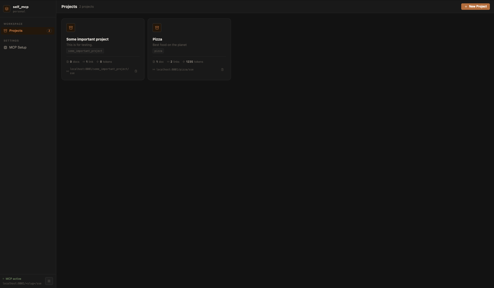
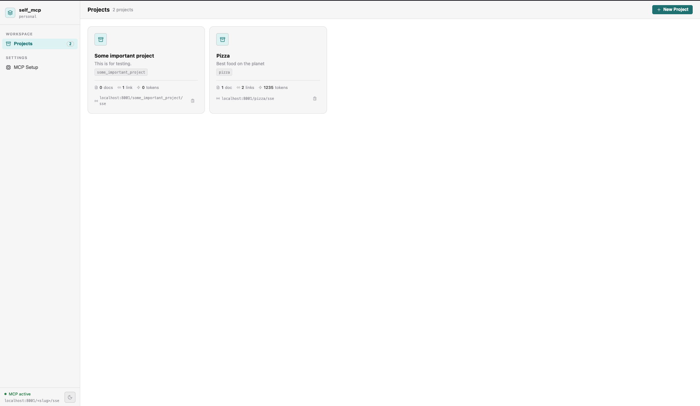

# self_mcp

A local workspace for AI tasks and project knowledge. Add your own model providers,
continue tasks, and reuse documents and generated results through your project's MCP connection.

## Start here

Use Python 3.12 on macOS or Linux (Windows needs WSL; native Windows is not supported).
From the project folder, with `uv` installed:

```sh
uv sync --frozen
.venv/bin/python start.py
```

Or create a Python 3.12 virtual environment and install `requirements.txt` with pip.
The locked `uv` setup is preferred for the same dependency versions on each machine.
Installation needs internet access to download dependencies. Token counting ships
with the app and needs no extra download at first use.

1. Open **http://127.0.0.1:8000**.
2. Choose your provider, paste its API key, and click **Save and continue**.
   Saving checks the connection; no model name is required. Secure key storage is
   selected when available. If only server memory is available, re-enter the key after a restart.
3. Open **Personal**, or create a project, then select **Tasks**.
4. Write your request and start. Models are selected from the chosen provider.
   Use **Ask a model** for one answer or **Delegate a task** for several workers and review.
5. Enable **Project knowledge** to include relevant saved material. Copy the project's
   URL from **MCP Setup** when connecting an external client.

Keep the terminal open. **Ctrl+C** stops the app and releases port 8000.
A connection check lists models; it does not prove that a provider will accept a
generation request or that your account has credit. Paid calls begin when you submit a task.

## Sharing with others

The current version is a **local pilot**, not a hosted multi-user service. You can
share this source folder; each person sets up their own keys and private local data.
Do not include your `~/.self_mcp` folder or credentials in the files you distribute.

For two people to share live knowledge, the next step is one shared project service
with sign-in, project invitations, and separate provider keys for each person.
Project writes now use locks and atomic file replacement, so simultaneous additions
do not discard each other. This does not yet add user accounts or resolve two edits
to the same document: the last saved edit wins. Do not expose port 8000 publicly or
use a cloud-synced JSON file as a shared database. See [collaboration design](docs/COLLABORATION.md).

## Provider Setup

Open **Settings → Providers** in the sidebar, or visit `/providers`.
First-time users without configured access see a setup dialog. Choose OpenAI,
Anthropic, a new Ollama connection, or an OpenAI-compatible endpoint. Keys are
optional for keyless local servers. Test the connection, optionally choose a default
model, and save. Saving automatically checks new keys and new endpoints before saving;
the separate test button is optional. Leave the preferred model blank for automatic selection.
Choose **Set up
later** to dismiss onboarding and continue using project features; Providers
settings remain available at any time. Closing first-time onboarding also records
that choice. Existing environment or app-managed credentials skip onboarding.

Environment credentials are detected only in the running API process, not in
another terminal's environment or an external AI client's login session. Startup
does not automatically test keys or call a model. Provider status distinguishes
credential presence from a successful connection test. OAuth/provider sign-in,
and account registration are not part of provider setup. Automatic task-to-model
selection is available separately through saved usage preferences and the Tasks tab.

The dialog supports keyboard dismissal, focus isolation, and scrolling on short
screens. Keys are cleared when it closes and are never stored in browser storage.
Markdown preview is sanitized with pinned DOMPurify; if the CDN is unavailable,
preview falls back to plain text rather than rendering unsanitized HTML.

Provider onboarding requires Python 3.12 and is available under `/api/providers`.
It does not change existing MCP or orchestration behavior or project tabs.
The normal requirements and project dependencies include `keyring>=25,<26` for
OS credential storage as well as HTTP model listing support. Installing keyring
does not guarantee that the operating system has an available, unlocked backend.
Missing, locked, unsupported, or unavailable keyrings fail gracefully; there is no
plaintext credential fallback. Alternate file keyrings and chained backends are
not used. `keyring_available` is a best-effort backend/read availability check;
an OS prompt or write failure can still occur when saving.

- `OPENAI_API_KEY` and `ANTHROPIC_API_KEY` take precedence over app credentials.
- Saving an input key while the corresponding environment variable is set returns
  HTTP 409. Omit `api_key` to change settings without changing credentials.
- Session storage lasts for the **API process lifetime**, is shared by all local
  clients, and is not browser-session isolation. Reloading/restarting loses it.
- Saving an input session key removes the older app-managed keyring credential
  when keyring is accessible. If no backend is available, session saves remain
  usable but return an explicit warning: this is **not a confirmed session-only
  switch**. An older persisted key cannot be inspected or removed and may become
  active again after restart when keyring access returns. Restore keyring access
  and save the session key again to remove it. A backend that exists but fails to
  read or delete its credential causes HTTP 503 instead of reporting success.
- Keyring storage uses service `self_mcp.providers`, with the provider ID as the
  account. Settings-only saves do not move or replace existing credentials.
- Non-secret model/default/onboarding preferences live separately in
  `~/.self_mcp/provider_settings.json`, using locking and atomic replacement.
- All endpoints require a loopback peer and Host. Browser Origin must exactly
  equal the request's scheme and Host (including port). CLI may omit Origin.
  Forwarding headers are rejected. This API is not designed for reverse proxies.
- Every write, **including bodyless DELETE**, requires
  `Content-Type: application/json`. Validation and upstream errors never echo keys.

Built-in API shapes (all successful responses use HTTP 200; custom profiles add metadata and routing fields):

```text
GET /api/providers
-> {providers: [{id: "openai"|"anthropic", name: string, configured: boolean,
                source: "environment"|"keyring"|"session"|null,
                default_model: string|null}],
    keyring_available: boolean, default_provider: string|null,
    onboarding_dismissed: boolean}

POST /api/providers/{provider}/test
   {api_key?: string, model?: string}
-> {models: [{id: string, name: string}], message: string}

PUT /api/providers/{provider}
   {api_key?: string, storage: "session"|"keyring", model?: string,
    make_default?: boolean}  // defaults to true
-> {message: string}

DELETE /api/providers/{provider}
-> {message: string}

POST /api/providers/onboarding
   {dismissed: boolean}
-> {onboarding_dismissed: boolean}
```

Testing uses the supplied key, if present, otherwise the resolved credential; it
never saves it. Testing authenticates to the provider's fixed `/v1/models`
endpoint and **does not verify inference**. The optional `model` is validated but
does not select or invoke a model. Anthropic listing stops after five pages of
100 models; responses indicate truncation. Listing has a 30-second overall deadline,
a 5-second connect timeout, and 10-second HTTP operation timeouts. Requests
do not follow redirects or use environment proxies.

Saving requires a credential. The model ID is optional; blank clears the saved preference.
A supplied model ID allows at most 200 ASCII letters,
digits, dots, underscores, colons, slashes, or hyphens; first character alphanumeric).
Input keys must be 1-4096 printable ASCII characters without spaces. Bodies are
limited to 16 KiB. Saving does not call the provider. Removing clears app-managed
credentials, model, and its default-provider selection, but cannot unset environment
variables. If keyring is unavailable, the response explicitly warns that any
existing keyring credential could not be removed. An environment-backed provider
therefore remains configured after deletion. A default/model preference can also
remain after a restart has discarded its session credential; use `configured`
to determine current credential availability.

Preference writes are atomic, and session changes are committed only after those
writes succeed. Keyring changes are rolled back on handled write/update failures;
the rollback credential exists only in memory, never in JSON or a disk journal.
If rollback also fails, HTTP 503 explicitly reports uncertain keyring state and
asks you to inspect the OS credential store and retry. JSON preferences and
session credentials remain unchanged in that case. These operations are not a
crash-atomic transaction across the OS keyring and filesystem: a process crash
between their commits can still leave them inconsistent. Other processes directly
editing the OS keyring are outside the preferences lock.

Errors use `{detail: string}` with sanitized messages: 401 authentication/access,
403 local/origin guard, 404 unknown provider, 409 environment override, 413 body
limit, 415 non-JSON write, 422 validation/missing credential, 429 rate limit,
502 upstream/network, 503 keyring/preferences, or 504 upstream timeout.

Run isolated tests with `.venv/bin/python -m unittest discover -s tests -v`.
Tests use temporary preferences, fake environment values, mocked keyrings, and
mocked upstream HTTP; no server or real credential is needed.

For browser checks, install Playwright separately, then run
`node tests/provider_ui.cjs`. If it is not installed in the project, set
`PLAYWRIGHT_MODULE` to the package path. Set `CHROME_PATH` to an installed Chrome
executable, or install Playwright's Chromium. These checks intercept local pages
and mock all APIs; they open no listening ports, do not start `start.py`, use your keys, or
touch project data. They cover onboarding, skip/revisit, failed/successful tests,
save/remove, environment detection, mobile dialog scrolling, and existing tabs.

## Local Models, Free Tiers, and Usage Preferences

Add **Ollama** (`http://localhost:11434`) or an **OpenAI-compatible endpoint** such as
LM Studio (`http://localhost:1234/v1`) in Providers settings. Start the server and
install/load its models first; this app will discover them, not download them.
Named connections can be added later without changing application code.

Save a provider allowlist and choose **Local only**, **Prefer local**, **Balanced**,
or **Prefer stronger models**. New connections are not automatically opted in.
For hosted free tiers, restrict the profile's **Approved model IDs** to the exact
models you intend to use; pricing and quotas are controlled by that service.

**Local only** excludes remote endpoints and recognized Ollama cloud-backed models.
Native model metadata is checked before generation, but a local proxy you configure
can still forward remotely—use trusted servers. Custom HTTP endpoints must be on
loopback; other endpoints require HTTPS. OAuth/Copilot account login is not supported.

See [docs/PROVIDERS.md](docs/PROVIDERS.md) for setup, protocols, permissions, model
restrictions, token budgets, credential storage, and extension points.

## Model Workspace

Open a project and select **Tasks**. This is separate from Documents, Links, Issues,
and provider settings; it does not restore the old Plans tab.

1. Choose **Ask a model** for a direct answer, or **Delegate a task** for planning,
   workers, and review. Enter your request. **Project knowledge** retrieves relevant passages from this project's
   documents, link descriptions and saved task results for each model call (up to 1,500 context tokens).
   Open **Work details → Knowledge used** to inspect the exact evidence supplied. Link targets are not fetched.
2. Select **Automatic · approved connections** to use the providers allowed by your saved usage
   preferences, or select a single configured provider. Discovery runs at task start.
   In direct mode, **Load models** lets you select a model on a specific connection.
   Open **Settings** to inspect the team pool, pin lead/worker models, or adjust limits.
3. Set the maximum subtask count and revision rounds, acknowledge provider charges,
   and click **Start task** or **Ask model**. This immediately starts real model calls.
4. For delegated work, leave **Correct an invalid plan or review once** enabled in Settings to repair malformed plan/review JSON,
   or disable it to avoid additional correction calls. All calls share the run limit.
5. Watch the concise progress status. Open **Work details** for subtasks, dependencies,
   reviews, usage, and the activity log. A rejected draft reruns selected tasks
   and their dependent tasks, up to the configured limit.
6. Copy the final reviewed draft or cancel an active run. Leaving the tab does not
   cancel work; restarting/reloading the API interrupts it without automatic replay.

**Ask a model** normally makes one inference call per message and saves the answer
without a planner or reviewer. After the answer, type a change and choose **Send
follow-up**: the same task receives earlier messages and results as context. Both
modes share cancellation, history, project knowledge,
and provider permissions. Automatic model recovery remains bounded; a specifically
selected model stays pinned.

The workspace resumes one task per project: the last task used in this browser tab,
or the most recently updated saved task on a first visit. There is no task-history
sidebar or new-task button. Earlier messages remain available in the details drawer,
and the last successful answer stays visible while a follow-up runs or fails.
Unsent messages and model preferences survive refreshes in this tab; sending consent
is never restored. Use **Send follow-up** or **⌘/Ctrl + Enter** to keep building. History is saved in `~/.self_mcp/task_runs.json`; refreshes and
API restarts retain it. Follow-ups wait for the current answer to finish or be
cancelled. Retries reuse a message ID so an uncertain HTTP reply cannot duplicate
the same follow-up. All turns stay saved; a bounded context window keeps the original
goal, latest exchange and most recent successful result, plus older turns that fit.

Delegated work now keeps every worker draft version. The lead must account for
each task, explain concrete revisions, and specify what to preserve. Workers receive
targeted feedback, while unaffected work stays in place. A bounded shared context
carries review decisions and earlier worker excerpts between models and follow-ups.
The final review delivers the best available draft even if concerns remain. It is
labelled **needs review**, includes unresolved notes, and can be improved with a
follow-up. If the reviewer supplies no final text at that point, the app collects
the saved worker drafts without another model call. The default is two revisions,
with up to three allowed after the initial draft to bound cost and repeated work.
Inspect **Work details** for versions, per-task reviews and shared context. These
remain model judgments; no code is executed or independently verified.

Model capabilities live in `src/model_capabilities.json`, separately from routing.
GPT-6 Astra defaults to a five-minute call timeout and low reasoning; built-in OpenAI
gets a 16,384-token output budget. Custom connections retain their configured token
limits. Optional per-run settings support longer timeouts and output budgets within
bounds. Errors distinguish timeout, exhausted output budget, HTTP status, and model
access, with a suggested next action. See [provider details](docs/PROVIDERS.md).

Leave model selection on **Automatic selection for each task**. A small lookup
policy favors coding models for implementation, compact models for extraction and
writing, and stronger models for planning and reasoning. This works within one
connection or across your approved connections, without an extra routing LLM call.
Known chat-incompatible IDs such as `gpt-3.5-turbo-instruct` are excluded.

Recognized model availability failures can switch to an approved alternative, with
at most three model attempts per call and the same overall run limits. The task
details and activity log show the actual model and any switches. Manually choosing
a model pins that role; automatic recovery never expands provider/model permissions
or bypasses local-only mode. Authentication and billing failures still need your
attention. Recommendations are heuristics, not price or quality guarantees. Copilot
authentication is not supported yet. Workers have separate task context; the lead
performs planning, review, and final synthesis.

This version generates **text and code drafts only**. It does not execute code,
run scientific simulations, browse, or change project files. In particular, a VQE
answer must not be treated as an experimentally verified result. The final output
always includes a server-controlled notice that code/simulations were not executed.

Run data remains in JSON at `~/.self_mcp/task_runs.json`, separate from project
content and provider credentials. Updates are locked and atomically replaced.
Use one API worker; a process lease prevents conflicting workflow owners. There
are at most two simultaneous upstream calls, 20 admitted runs, a 15-minute deadline
per run, and finite call/token/revision limits. These are not a dollar-cost cap.

See [docs/TASKS.md](docs/TASKS.md) for the API and execution contract. Run
`node tests/tasks_ui.cjs` with the same Playwright setup described above for the
mocked browser regression suite; backend tests remain under unittest discovery.

## Preview




## Run teams from an MCP client

Saved task results are automatically available as project knowledge through the
same MCP connection. This includes existing results, final answers, successful
worker drafts from partial/failed runs, all saved draft versions, earlier messages,
and review notes. New saves become readable immediately; no export step or extra
model call is needed. Results retain their task/message IDs, source model, version,
and review status. Sharing is confined to the connected project.

Use **`search_project_knowledge`** for ranked matching passages across this project's
documents, saved link descriptions and generated results. It accepts a `query`
and optional `token_budget` (default 1,500), and returns source IDs, review/version
status, character offsets and retrieval timing. Use **`get_project_knowledge`**
with a returned `source_id` to expand a passage. No tool accepts another project ID.
The API agents use the same retrieval service when **Project knowledge** is enabled.
The index lives in memory, refreshes on file changes, and makes no model calls.
First-time indexing takes longer than cached searches; there is no SQL dependency.

The original tools remain available: `search_task_results` for substring matching, `list_task_results` to browse (optionally
filter by `run_id`), and `get_task_result` with a returned `result_id` to read it.
Listings/searches return `next_offset` for pagination. Reads return up to 12,000
characters by default (20,000 maximum); continue at `next_offset` until it is null
to retrieve the full output. The `task-knowledge://<project-id>/index` MCP resource
provides a live index, and returned `task-result://...` URIs support paged reads.
Generated knowledge is reference material, with explicit unreviewed/revision
labels; approval is a model judgment, not execution or independent verification.
MCP clients choose which results to retrieve and include in their own context.

After updating the application, restart it yourself and reconnect clients to load
the new tool catalog. Subsequent task saves require no restart. The knowledge view
keeps file-invalidated snapshots of the saved sources, preserving full outputs without the document store's
2,000-token limit or duplicate documents.

Run `.venv/bin/python start.py` and keep that terminal open. The workspace, API,
and MCP all run together at `http://127.0.0.1:8000`; no second server is needed.
Open **MCP Setup**, find your project, click **Test connection**, then **Config**.
Merge the copied `mcp` block into `~/.config/opencode/opencode.json` and restart
OpenCode. Use `opencode mcp list` to confirm the connection.

Project URLs are absolute, including `http://`:
`http://127.0.0.1:8000/mcp/<project-slug>/mcp` (Streamable HTTP).
For example, OpenCode 1.x uses:

```json
{"mcp":{"self_mcp_forward_gradient":{"type":"remote","url":"http://127.0.0.1:8000/mcp/forward_gradient/mcp","enabled":true,"oauth":false,"timeout":10000}}}
```

Use the slug generated by your own project. A project-level `opencode.json` can
override global settings; check it if a server still shows disabled. The local
connection needs no login. Reading project knowledge makes no model calls;
explicitly starting/continuing supervised work still uses your configured models.
Both clients use the same saved project and task data. Connecting OpenCode does
not automatically import its entire chat transcript; use the task tools to read
or continue the workspace task.

Discovery is `/mcp/stores` and health is `/mcp/health` on the workspace port.
Mounted SSE remains available at `/mcp/<slug>/sse`, with messages under
`/mcp/<slug>/messages/`. If an older client must keep its port-8001 URL, run
`.venv/bin/python src/mcp_server.py` separately; the default launcher no longer
starts this legacy service. Starting an already-used port reports the conflict
without killing processes. **Ready** is printed only after startup succeeds.
Press **Ctrl+C** once and wait for **Stopped** before starting again. Open MCP
streams get up to five seconds to drain, then are cancelled so shutdown can save
task state and release the runner lock. Port 8000 is closed even on failed startup;
port 8001 is not opened by the launcher. Restart manually after code changes.
If an older process still holds the runner lock, startup reports it (including its
PID when available); stop that process before retrying. Do not delete the lock
file to bypass a running process.
Configure model connections in **Settings → Providers** before submitting work.

- `task_providers`: inspect configured connections and automatic routing permissions.
- `task_model_options`: discover models for a provider ID or `auto`.
- `start_task_run`: start a new task with a goal, provider, limits and optional project context.
- `continue_task_run`: append a follow-up to the same task, using its saved history.
- `get_task_run` / `list_task_runs`: inspect progress, outputs and errors.
- `cancel_task_run`: stop an active run.

MCP and the GUI use the same API-owned runner and run history. This includes API
process session credentials, parallel workers, dependency scheduling, review and
revision. MCP submits through the fixed localhost API on port 8000; it never starts
a second runner or reads credentials. The retired `spawn_subagent` CLI launcher is
no longer advertised. Legacy manual plans remain available, but are separate from
supervised task runs. Both servers bind to localhost; MCP rejects remote peers,
foreign Host/Origin values and forwarding headers.

Example `start_task_run` arguments:

```json
{
  "goal": "Use the attached specification to draft an implementation and review it",
  "provider": "auto",
  "include_project_context": true,
  "schema_retries": 1,
  "max_tasks": 4,
  "max_revisions": 1
}
```

This supports OpenAI, Anthropic, Ollama and configurable OpenAI-compatible model
APIs. It is not a connector for arbitrary account logins or external MCP tools;
workers currently produce text/code drafts and cannot execute tools or files.

The Tasks screen focuses on the current task, its latest answer, and a compact
composer below it. **Settings** contains model overrides
and budgets. A single progress line links to a details drawer with expandable task
rows, reviews, usage, and logs. Formatted answers include **Copy
code** buttons for individual code blocks and **Copy result** for the full text.
Formatting uses sanitized Markdown, with plain text as a fallback if the formatting
libraries cannot load. Reviews, provider usage and the activity log remain available
in the details drawer. Older separate tasks remain saved and accessible through
the API/MCP; removing the history sidebar does not delete their outputs.
